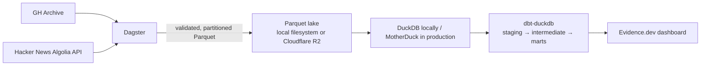

# Architecture

The pipeline ingests public GitHub events and Hacker News stories into a
partitioned Parquet lake. The GH Archive Dagster asset writes selected hourly
events under `raw/gh_events/` and invalid rows under `quarantine/gh_events/`.
The daily Hacker News asset queries the Algolia API and stores stories under
`raw/hn_stories/`, with invalid hits under `quarantine/hn_stories/`. Hourly GH
and daily HN schedules ingest completed UTC partitions; a GH freshness check
fails when the newest materialized hour is over six hours old. Dagster
orchestrates the work, DuckDB or MotherDuck provides analytical compute, dbt
builds staging models from external Parquet sources (`data/lake` in development
or Cloudflare R2 in the MotherDuck production target), and Evidence.dev serves
the dashboard. The intermediate layer aggregates GitHub activity per
repository/day and links HN stories to GitHub repositories. A daily Dagster
asset fetches metadata for the most active repositories, caches REST responses,
and dbt snapshots changes to repository language, description, and topics as
SCD Type 2 history.
